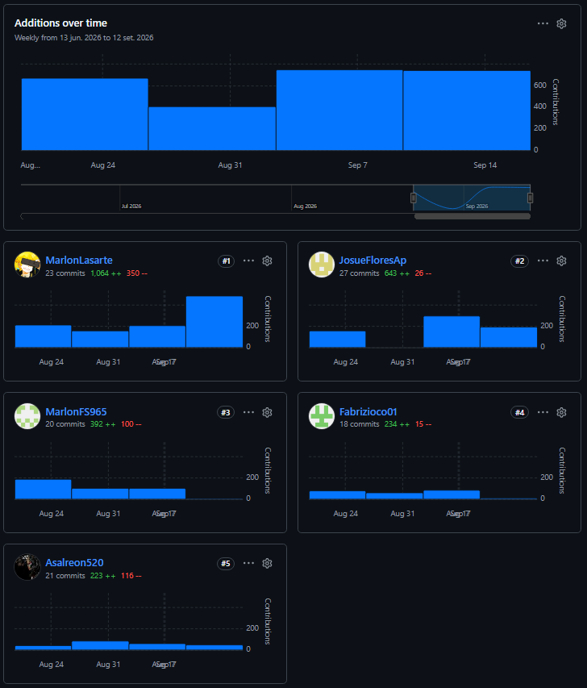
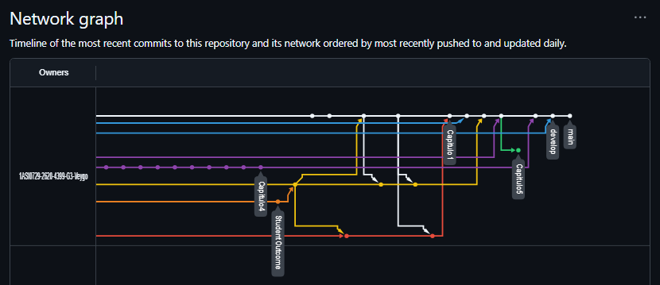
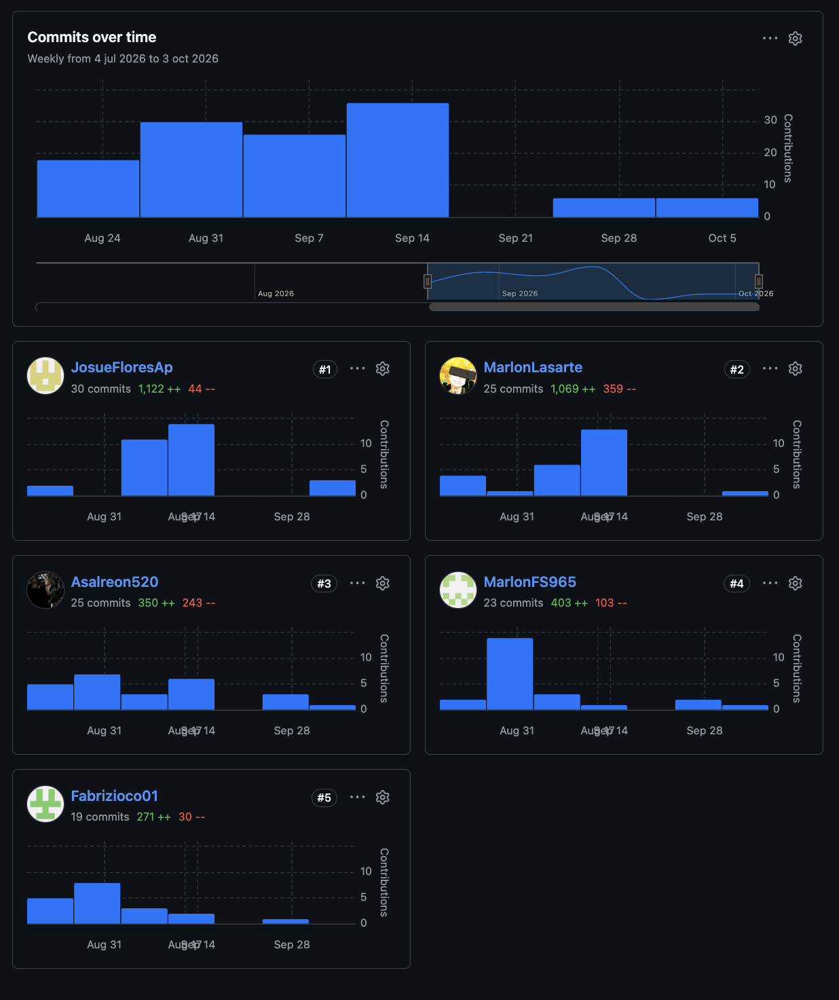
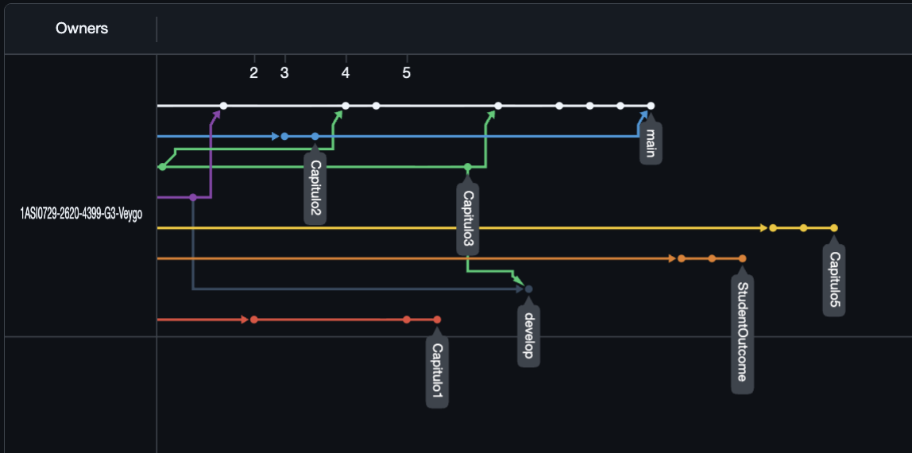

  
  
  
  <h1>Universidad Peruana de Ciencias Aplicadas</h1>
  <h2>Carrera de Ingeniería de Software</h2>
  
   
  
  <h2>1ASI0730</h2>
  <h2>Aplicaciones Web</h2>

  <h3>NRC</h3>
  <h2>16712</h2>
  
   
  
  <h1>Informe del Trabajo Final</h1>

   

  <h3>Docente</h3>
  <h2>Sánchez Seña, Alberto Wilmer</h2>

   

  <h3>Equipo</h3>
  <h2>Zyntra</h2>

  <h3>Proyecto</h3>
  <h2>Veygo</h2>

   

  <h3>Integrantes</h3>

| Código | Apellidos y Nombres |
| :---: | :--- |
| U20201F773 | Josue Antonio Flores Apaico |
| U202410869 | Fabrizio Hamet Cano Ortiz |
| U202415412 | Marlon Alessandro Flores Siguas |
| U20241A995 | Ivonne Beatriz Ibañez Torres |
| U20221A390 | Eddo Su Caletti |

   
  
  <h3>Periodo 202620</h3>
  <h3>Septiembre 2026</h3>
  

---

## Registro de Versiones del Informe

| Versión | Fecha | Autor | Descripción de modificación |
|:---:|:---:|:---|:---|
| 0.1 | 17/09/2026 | Josue Antonio Flores Apaico Fabrizio Hamet Cano Ortiz Marlon Alessandro Flores Siguas Ivonne Beatriz Ibañez Torres Eddo Su Caletti | **Entrega AV1 – Sprint Review (Semana 4)** Se agregaron: Carátula, Registro de Versiones del Informe, Project Report Collaboration Insights, Contenido y Student Outcome. **Capítulo I:** Introducción. **Capítulo II:** Requirements Elicitation & Analysis. **Capítulo III:** Requirements Specification. **Capítulo IV:** Product Design. **Capítulo V:** Product Implementation, Validation & Deployment: 5.1. Software Configuration Management (5.1.1 a 5.1.4). 5.2. Landing Page, Services & Applications Implementation. 5.2.1. Sprint 1 (5.2.1.1 Sprint Planning 1 a 5.2.1.8 Team Collaboration Insights during Sprint). Conclusiones, Bibliografía y Anexos. Se implementó y desplegó la primera versión de la Landing Page. |
| 1.0 | 05/10/2026 | Josue Antonio Flores Apaico Fabrizio Hamet Cano Ortiz Marlon Alessandro Flores Siguas Ivonne Beatriz Ibañez Torres Eddo Su Caletti | **Entrega TB1 – Stage Review (Semana 7)** Se actualizaron: Registro de Versiones del Informe, Project Report Collaboration Insights (TB1) y Student Outcome (aportes TB1). **Corrección y mejora de artefactos previos:** carátula, Lean UX Process y Lean UX Canvas (1.2.2), imágenes de entrevistas (2.2.2), Product Backlog con orden, Epic ID y Story Points (3.3), Design-Level EventStorming (4.6.1) y diagramas C4 de contexto, contenedores y componentes (4.6.2 a 4.6.4). **Capítulo V:** se agregó 5.2.2. Sprint 2: 5.2.2.1. Sprint Planning 2. 5.2.2.2. Aspect Leaders and Collaborators. 5.2.2.3. Sprint Backlog 2. 5.2.2.4. Development Evidence for Sprint Review. 5.2.2.5. Execution Evidence for Sprint Review. 5.2.2.6. Services Documentation Evidence for Sprint Review. 5.2.2.7. Software Deployment Evidence for Sprint Review. 5.2.2.8. Team Collaboration Insights during Sprint. Se actualizaron Conclusiones, Bibliografía y Anexos. Se desplegó una nueva versión de la Landing Page y la primera versión del Frontend Web Application. |
| 1.1 | 10/11/2026 | Josue Antonio Flores Apaico Fabrizio Hamet Cano Ortiz Marlon Alessandro Flores Siguas Ivonne Beatriz Ibañez Torres Eddo Su Caletti | **Entrega AV2 – Sprint Review (Semana 12)** Se actualizaron: Registro de Versiones del Informe, Project Report Collaboration Insights (AV2) y Student Outcome (aportes AV2). **Corrección y mejora de artefactos previos:** historias de usuario refactorizadas en formato BDD y subsanación de observaciones del informe técnico. **Capítulo V:** se agregó 5.2.3. Sprint 3: 5.2.3.1. Sprint Planning 3. 5.2.3.2. Aspect Leaders and Collaborators. 5.2.3.3. Sprint Backlog 3. 5.2.3.4. Development Evidence for Sprint Review. 5.2.3.5. Execution Evidence for Sprint Review. 5.2.3.6. Services Documentation Evidence for Sprint Review. 5.2.3.7. Software Deployment Evidence for Sprint Review. 5.2.3.8. Team Collaboration Insights during Sprint. Se agregó 5.3. Validation Interviews: 5.3.1. Diseño de Entrevistas. 5.3.2. Registro de Entrevistas. 5.3.3. Evaluaciones según heurísticas. Se agregó 5.4. Video About-the-Product y Video About-the-Team. Se actualizaron Conclusiones, Bibliografía y Anexos. Se desplegó una nueva versión de la Landing Page, la nueva versión del Frontend Web Application y la primera versión de los Web Services (Backend). |
---

## Project Report Collaboration Insights

En esta sección se indica el URL del repositorio utilizado para la elaboración colaborativa del Informe de Trabajo Final, así como las evidencias de participación de cada integrante del equipo durante el desarrollo de las entregas.

| Tipo de Enlace                      | URL                                                                                   |
|------------------------------------|----------------------------------------------------------------------------------------|
| **Repositorio de la organización** | https://github.com/1ASI0729-2620-4399-G3-Veygo                                |
| **Repositorio del reporte**        | https://github.com/1ASI0729-2620-4399-G3-Veygo/report.git         |
| **Landing Page**                   | https://1asi0729-2620-4399-g3-veygo.github.io/landing-Page/     |
| **Frontend**        | https://github.com/1ASI0729-2620-4399-G3-Veygo/frontend.git         |
| **Fake API**        | https://veygo-fake-api.onrender.com/api/v1         |
| **Backend**        | https://github.com/1ASI0729-2620-4399-G3-Veygo/backend.git         |
| **Deploy Frontend**        |  https://veygo-web-app.web.app         |
| **Deploy Backend**        | ---         |

### AV1

Durante el desarrollo de la entrega AV1, el equipo distribuyó la elaboración del informe asignando capítulos y secciones específicas a cada integrante según sus áreas de responsabilidad. Cada miembro realizó sus aportes directamente en el repositorio de GitHub mediante commits en ramas individuales, siguiendo la convención de Conventional Commits, y luego integrando los cambios mediante Pull Requests hacia la rama develop y después pasando todo a la rama main. Todos los integrantes participaron activamente en la redacción de secciones del informe, asegurando coherencia y calidad en el contenido entregado. 
Se presenta la evidencia de trabajo segun los Insights de Github.

---
### TB1
Durante la etapa TB1, el equipo realizó la revisión y corrección de las observaciones brindadas por el profesor sobre la entrega AV1, mejorando la documentación y los requisitos del proyecto. Asimismo, se inició la implementación del Frontend web, desarrollando la Landing Page y los componentes de los módulos de Booking y Engagement. Los avances fueron gestionados mediante GitHub, utilizando commits bajo la convención de Conventional Commits, ramas individuales y Pull Requests para integrar los cambios hacia develop y posteriormente main.
Se presenta la evidencia del trabajo realizado según los Insights de GitHub.

### AV2
Durante la etapa del AV2 (Sprint 3), el equipo continuó el avance del proyecto mediante la mejora continua de los artefactos previos y la integración de nuevos componentes de software. Se concretó el despliegue de una nueva versión de la Landing Page, la nueva versión del Frontend Web Applications y la primera versión de los Web Services (Backend). Los avances en el código fuente fueron gestionados mediante GitHub, aplicando la convención de Conventional Commits, ramas individuales por funcionalidad y Pull Requests para integrar los cambios hacia la rama develop y posteriormente a main.

A continuación, se presentan las evidencias del trabajo y colaboración en el repositorio correspondientes a los Insights de GitHub:

# Indice

- [Student Outcome](#student-outcome)

- [Capítulo I: Introducción](Zyntra/Chapter1.md#11-startup-profile)
    - [1.1. Startup Profile](Zyntra/Chapter1.md#11-startup-profile)
        - [1.1.1. Descripción de la Startup](Zyntra/Chapter1.md#111-descripción-de-la-startup)
        - [1.1.2. Perfiles de integrantes del equipo](Zyntra/Chapter1.md#112-perfiles-de-integrantes-del-equipo)
    - [1.2. Solution Profile](Zyntra/Chapter1.md#12-solution-profile)
        - [1.2.1 Antecedentes y problemática](Zyntra/Chapter1.md#121-antecedentes-y-problemática)
        - [1.2.2 Lean UX Process](Zyntra/Chapter1.md#122-lean-ux-process)
            - [1.2.2.1. Lean UX Problem Statements](Zyntra/Chapter1.md#1221-lean-ux-problem-statements)
            - [1.2.2.2. Lean UX Assumptions](Zyntra/Chapter1.md#1222-lean-ux-assumptions)
            - [1.2.2.3. Lean UX Hypothesis Statements](Zyntra/Chapter1.md#1223-lean-ux-hypothesis-statements)
            - [1.2.2.4. Lean UX Canvas](Zyntra/Chapter1.md#1224-lean-ux-canvas)
    - [1.3. Segmentos objetivo](Zyntra/Chapter1.md#13-segmentos-objetivo)

- [Capítulo II: Requirements Elicitation & Analysis](Zyntra/Chapter2.md#capítulo-2-requirements-elicitation--analysis)
    - [2.1. Competidores](Zyntra/Chapter2.md#21-competidores)
        - [2.1.1. Análisis competitivo](Zyntra/Chapter2.md#211-análisis-competitivo)
        - [2.1.2. Estrategias y tácticas frente a competidores](/Zyntra/Chapter2.md#212-estrategias-y-tácticas-frente-a-competidores)
    - [2.2. Entrevistas](Zyntra/Chapter2.md#22-entrevistas)
        - [2.2.1. Diseño de entrevistas](Zyntra/Chapter2.md#221-diseño-de-entrevistas)
        - [2.2.2. Registro de entrevistas](Zyntra/Chapter2.md#222-registro-de-entrevistas)
        - [2.2.3. Análisis de entrevistas](Zyntra/Chapter2.md#223-análisis-de-entrevistas)
    - [2.3. Needfinding](Zyntra/Chapter2.md#23-needfinding)
        - [2.3.1. User Personas](Zyntra/Chapter2.md#231-user-personas)
        - [2.3.2. User Task Matrix](Zyntra/Chapter2.md#232-user-task-matrix)
        - [2.3.3. User Journey Mapping](Zyntra/Chapter2.md#233-user-journey-mapping)
        - [2.3.4. Empathy Mapping](Zyntra/Chapter2.md#234-empathy-mapping)
    - [2.4. Big Picture EventStorming](Zyntra/Chapter2.md#24-big-picture-eventstorming)
    - [2.5. Ubiquitous Language](Zyntra/Chapter2.md#25-ubiquitous-language)

- [Capítulo III: Requirements Specification](Zyntra/Chapter3.md#capítulo-iii-requirements-specification)
    - [3.1. User Stories](Zyntra/Chapter3.md#31-user-stories)
    - [3.2. Impact Mapping](Zyntra/Chapter3.md#32-impact-mapping)
    - [3.3. Product Backlog](Zyntra/Chapter3.md#33-product-backlog)

- [Capítulo IV: Product Design](Zyntra/Chapter4.md#capítulo-iv-product-design)
    - [4.1. Style Guidelines](Zyntra/Chapter4.md#41-style-guidelines)
        - [4.1.1. General Style Guidelines](Zyntra/Chapter4.md#411-general-style-guidelines)
        - [4.1.2. Web Style Guidelines](Zyntra/Chapter4.md#412-web-style-guidelines)
    - [4.2. Information Architecture](Zyntra/Chapter4.md#42-information-architecture)
        - [4.2.1. Organization Systems](Zyntra/Chapter4.md#421-organization-systems)
        - [4.2.2. Labeling Systems](Zyntra/Chapter4.md#422-labeling-systems)
        - [4.2.3. SEO Tags and Meta Tags](Zyntra/Chapter4.md#423-seo-tags-and-meta-tags)
        - [4.2.4. Searching Systems](Zyntra/Chapter4.md#424-searching-systems)
        - [4.2.5. Navigation Systems](Zyntra/Chapter4.md#425-navigation-systems)
    - [4.3. Landing Page UI Design](Zyntra/Chapter4.md#43-landing-page-ui-design)
        - [4.3.1. Landing Page Wireframe](Zyntra/Chapter4.md#431-landing-page-wireframe)
        - [4.3.2. Landing Page Mock-up](Zyntra/Chapter4.md#432-landing-page-mock-up)
    - [4.4. Web Applications UX/UI Design](Zyntra/Chapter4.md#44-web-applications-uxui-design)
        - [4.4.1. Web Applications Wireframes](Zyntra/Chapter4.md#441-web-applications-wireframes)
        - [4.4.2. Web Applications Wireflow Diagrams](Zyntra/Chapter4.md#442-web-applications-wireflow-diagrams)
        - [4.4.3. Web Applications Mock-ups](Zyntra/Chapter4.md#443-web-applications-mock-ups)
        - [4.4.4. Web Applications User Flow Diagrams](Zyntra/Chapter4.md#444-web-applications-user-flow-diagrams)
    - [4.5. Web Applications Prototyping](Zyntra/Chapter4.md#45-web-applications-prototyping)
    - [4.6. Domain-Driven Software Architecture](Zyntra/Chapter4.md#46-domain-driven-software-architecture)
        - [4.6.1. Design-Level EventStorming](Zyntra/Chapter4.md#461-design-level-eventstorming)
        - [4.6.2. Software Architecture Context Diagram](Zyntra/Chapter4.md#462-software-architecture-context-diagram)
        - [4.6.3. Software Architecture Container Diagrams](Zyntra/Chapter4.md#463-software-architecture-container-diagrams)
        - [4.6.4. Software Architecture Components Diagrams](Zyntra/Chapter4.md#464-software-architecture-components-diagrams)
    - [4.7. Software Object-Oriented Design](Zyntra/Chapter4.md#47-software-object-oriented-design)
        - [4.7.1. Class Diagrams](Zyntra/Chapter4.md#471-class-diagrams)
    - [4.8. Database Design](Zyntra/Chapter4.md#48-database-design)
        - [4.8.1. Database Diagram](Zyntra/Chapter4.md#481-database-diagram)

- [Capítulo V: Product Implementation, Validation & Deployment](Zyntra/Chapter5.md#capítulo-v-product-implementation-validation--deployment)
    - [5.1. Software Configuration Management](Zyntra/Chapter5.md#51-software-configuration-management)
        - [5.1.1. Software Development Environment Configuration](Zyntra/Chapter5.md#511-software-development-environment-configuration)
        - [5.1.2. Source Code Management](Zyntra/Chapter5.md#512-source-code-management)
        - [5.1.3. Source Code Style Guide & Conventions](Zyntra/Chapter5.md#513-source-code-style-guide--conventions)
        - [5.1.4. Software Deployment Configuration](Zyntra/Chapter5.md#514-software-deployment-configuration)
    - [5.2. Landing Page, Services & Applications Implementation](Zyntra/Chapter5.md#52-landing-page-services--applications-implementation)
        - [5.2.1. Sprint 1](Zyntra/Chapter5.md#521-sprint-1)
            - [5.2.1.1. Sprint Planning 1](Zyntra/Chapter5.md#5211-sprint-planning-1)
            - [5.2.1.2. Aspect Leaders and Collaborators](Zyntra/Chapter5.md#5212-aspect-leaders-and-collaborators)
            - [5.2.1.3. Sprint Backlog 1](Zyntra/Chapter5.md#5213-sprint-backlog-1)
            - [5.2.1.4. Development Evidence for Sprint Review](Zyntra/Chapter5.md#5214-development-evidence-for-sprint-review)
            - [5.2.1.5. Execution Evidence for Sprint Review](Zyntra/Chapter5.md#5215-execution-evidence-for-sprint-review)
            - [5.2.1.6. Services Documentation Evidence for Sprint Review](Zyntra/Chapter5.md#5216-services-documentation-evidence-for-sprint-review)
            - [5.2.1.7. Software Deployment Evidence for Sprint Review](Zyntra/Chapter5.md#5217-software-deployment-evidence-for-sprint-review)
            - [5.2.1.8. Team Collaboration Insights during Sprint](Zyntra/Chapter5.md#5218-team-collaboration-insights-during-sprint)
        - [5.2.2. Sprint 2](Zyntra/Chapter5.md#522-sprint-2)
            - [5.2.2.1. Sprint Planning 2](Zyntra/Chapter5.md#5221-sprint-planning-2)
            - [5.2.2.2. Aspect Leaders and Collaborators](Zyntra/Chapter5.md#5222-aspect-leaders-and-collaborators)
            - [5.2.2.3. Sprint Backlog 2](Zyntra/Chapter5.md#5223-sprint-backlog-2)
            - [5.2.2.4. Development Evidence for Sprint Review](Zyntra/Chapter5.md#5224-development-evidence-for-sprint-review)
            - [5.2.2.5. Execution Evidence for Sprint Review](Zyntra/Chapter5.md#5225-execution-evidence-for-sprint-review)
            - [5.2.2.6. Services Documentation Evidence for Sprint Review](Zyntra/Chapter5.md#5226-services-documentation-evidence-for-sprint-review)
            - [5.2.2.7. Software Deployment Evidence for Sprint Review](Zyntra/Chapter5.md#5227-software-deployment-evidence-for-sprint-review)
            - [5.2.2.8. Team Collaboration Insights during Sprint](Zyntra/Chapter5.md#5228-team-collaboration-insights-during-sprint)
        - [5.2.3. Sprint 3](Zyntra/Chapter5.md#523-sprint-3)
            - [5.2.3.1. Sprint Planning 3](Zyntra/Chapter5.md#5231-sprint-planning-3)
            - [5.2.3.2. Aspect Leaders and Collaborators](Zyntra/Chapter5.md#5232-aspect-leaders-and-collaborators)
            - [5.2.3.3. Sprint Backlog 3](Zyntra/Chapter5.md#5233-sprint-backlog-3)
            - [5.2.3.4. Development Evidence for Sprint Review](Zyntra/Chapter5.md#5234-development-evidence-for-sprint-review)
            - [5.2.3.5. Execution Evidence for Sprint Review](Zyntra/Chapter5.md#5235-execution-evidence-for-sprint-review)
            - [5.2.3.6. Services Documentation Evidence for Sprint Review](Zyntra/Chapter5.md#5236-services-documentation-evidence-for-sprint-review)
            - [5.2.3.7. Software Deployment Evidence for Sprint Review](Zyntra/Chapter5.md#5237-software-deployment-evidence-for-sprint-review)
            - [5.2.3.8. Team Collaboration Insights during Sprint](Zyntra/Chapter5.md#5238-team-collaboration-insights-during-sprint)
    <!--
        - [5.2.4. Sprint 4](Zyntra/Chapter5.md#524-sprint-4)
            - [5.2.4.1. Sprint Planning 4](Zyntra/Chapter5.md#5241-sprint-planning-4)
            - [5.2.4.2. Aspect Leaders and Collaborators](Zyntra/Chapter5.md#5242-aspect-leaders-and-collaborators)
            - [5.2.4.3. Sprint Backlog 4](Zyntra/Chapter5.md#5243-sprint-backlog-4)
            - [5.2.4.4. Development Evidence for Sprint Review](Zyntra/Chapter5.md#5244-development-evidence-for-sprint-review)
            - [5.2.4.5. Execution Evidence for Sprint Review](Zyntra/Chapter5.md#5245-execution-evidence-for-sprint-review)
            - [5.2.4.6. Services Documentation Evidence for Sprint Review](Zyntra/Chapter5.md#5246-services-documentation-evidence-for-sprint-review)
            - [5.2.4.7. Software Deployment Evidence for Sprint Review](Zyntra/Chapter5.md#5247-software-deployment-evidence-for-sprint-review)
            - [5.2.4.8. Team Collaboration Insights during Sprint](Zyntra/Chapter5.md#5248-team-collaboration-insights-during-sprint)
    -->
    - [5.3. Validation Interviews](Zyntra/Chapter5.md#53-validation-interviews)
        - [5.3.1. Diseño de Entrevistas](Zyntra/Chapter5.md#531-diseño-de-entrevistas)
        - [5.3.2. Registro de Entrevistas](Zyntra/Chapter5.md#532-registro-de-entrevistas)
        - [5.3.3. Evaluaciones según heurísticas](Zyntra/Chapter5.md#533-evaluaciones-según-heurísticas)
    - [5.4. Video About-the-Product](Zyntra/Chapter5.md#54-video-about-the-product)

- [Conclusiones](Zyntra/6_Conclusions.md)
- [Bibliografía](Zyntra/7_Bibliography.md)
- [Anexos](Zyntra/8_Annexes.md)
---

# Student Outcome

En Ingeniería de software el logro contribuye a alcanzar el Student Outcome EAC 5: “Trabaja efectivamente en un equipo cuyos miembros juntos proporcionan liderazgo; crea un entorno colaborativo e inclusivo y establece metas, planifica tareas y cumple objetivos”. En el siguiente cuadro se describen las acciones realizadas y enunciados de conclusiones por parte del grupo, que permiten sustentar el haber alcanzado el logro de ABET-EAC-Student Outcome 5.

| Criterio específico | Acciones realizadas | Conclusiones |
| :---: | :---: | :---: |
|5.c.1 Trabaja en equipo para proporcionar liderazgo en forma conjunta | **Ivonne Beatriz Ibañez Torres:**   AV1: Trabajé de manera grupal y coordinadamente con mis compañeros, manteniendo comunicación constante y clara.   TB1: Participé de manera coordinada con los integrantes del equipo durante la preparación de la entrega, apoyando en la revisión de los avances, la organización de las tareas pendientes y la verificación del cumplimiento de los objetivos establecidos para el proyecto. Lideré la elaboración de 5.2.2.1. Sprint Planning 2 y 5.2.2.6. Services Documentation Evidence for Sprint Review, manteniendo comunicación constante con el equipo para facilitar la integración de los diferentes aportes y resolver observaciones encontradas durante el desarrollo.  AV2: Participé de manera activa y coordinada con el equipo en la preparación de la entrega AV2, liderando la logística y ejecución de las entrevistas de validación con usuarios (UX/UI) correspondientes a 5.3. Validation Interviews (5.3.1. Diseño de Entrevistas, 5.3.2. Registro de Entrevistas y 5.3.3. Evaluaciones según heurísticas). Asimismo, colaboré en la revisión general de los entregables, la actualización del informe técnico y la verificación del cumplimiento de las metas del Sprint 3 para el proyecto Veygo.    **Eddo Su Caletti**   AV1: Trabajé de manera elaborada organizando la repartición de los capítulos entre nuestros compañeros, además de revisar los errores encontrados en los mismos.   TB1: Asumí un rol activo en la gestión y coordinación del equipo, organizando de manera estratégica la distribución de los capítulos de la documentación técnica según las fortalezas individuales. Me encargué de 5.2.2.2. Aspect Leaders and Collaborators y de 5.2.2.8. Team Collaboration Insights during Sprint, y ejecuté revisiones continuas de Aseguramiento de Calidad (QA) sobre los entregables para identificar inconsistencias y garantizar el cumplimiento de los estándares de la carrera y del proyecto Veygo.  AV2: Como Team Leader, lideré la planificación del Sprint 3 (5.2.3.1. Sprint Planning 3) y la distribución estratégica de responsabilidades. Elaboré la evidencia de ejecución (5.2.3.5. Execution Evidence for Sprint Review), encabecé el diseño visual de la nueva versión de la Landing Page (paleta de colores, tipografía y maquetación), participé en el desarrollo Full-Stack (Frontend y Backend) del módulo de reservas (Booking), colaboré en las entrevistas de validación con usuarios y supervisé el QA de todos los artefactos y versiones desplegadas.     **Marlon Flores Siguas:**   AV1: Trabajé de manera coordinada con mis compañeros, participando en la elaboración del proyecto y apoyando en la revisión de los avances, manteniendo una comunicación constante para cumplir con los objetivos del trabajo grupal.   TB1: Participé en la revisión y mejora de los avances del proyecto, realizando las correcciones correspondientes a partir de las observaciones del profesor. Lideré la elaboración de 5.2.2.3. Sprint Backlog 2 y coordiné con mis compañeros para actualizar la documentación y asegurar que los entregables cumplieran con los criterios solicitados.    AV2: Participé en el desarrollo e implementación de componentes del Frontend Web Application y en el soporte a la integración con los Web Services (Backend). Me encargué de 5.2.3.3. Sprint Backlog 3, de 5.2.3.7. Software Deployment Evidence for Sprint Review y de la elaboración y grabación del Video About-the-Team. Asimismo, contribuí a la refactorización de historias de usuario en formato BDD, al control de versiones mediante ramas y Pull Requests en GitHub y a la subsanación continua de observaciones del informe técnico.    **Josue Antonio Flores Apaico:**   AV1: Trabajé de manera coordinada con mis compañeros manteniendo comunicación constante y actualizaciones cada cierto periodo de tiempo, cumpliendo exitosamente mis designaciones.   TB1: Participé activamente en la coordinación e integración del desarrollo de la Frontend Web Application de Veygo, apoyando a mis compañeros durante la incorporación de los diferentes módulos. Elaboré 5.2.2.4. Development Evidence for Sprint Review y 5.2.2.7. Software Deployment Evidence for Sprint Review, y contribuí en la organización del trabajo en GitHub y en la resolución de problemas encontrados durante la integración y despliegue del proyecto.   AV2: Participé activamente en el desarrollo y despliegue de la primera versión de los Web Services (Backend), así como en su integración con los módulos del Frontend Web Application. Elaboré 5.2.3.4. Development Evidence for Sprint Review y 5.2.3.6. Services Documentation Evidence for Sprint Review. Adicionalmente, colaboré en el modelado de datos, la gestión del repositorio en GitHub bajo Conventional Commits y la resolución de incidencias en el entorno de producción durante el Sprint 3.     **Fabrizio Cano Ortiz:**   AV1: Trabajé de manera colaborativa con mis compañeros durante el desarrollo del proyecto, manteniendo una buena comunicación para cumplir con los objetivos planteados.   TB1: Participé activamente en la revisión y corrección de la documentación del proyecto, coordinando con mis compañeros para subsanar las observaciones realizadas por el profesor. Elaboré 5.2.2.5. Execution Evidence for Sprint Review y contribuí a mantener una adecuada organización del repositorio mediante el uso de ramas, commits y Pull Requests.  AV2: Contribuí al desarrollo de la arquitectura Full-Stack, apoyando en la implementación de interfaces en el Frontend y en la configuración de endpoints en los Web Services. Me encargué de 5.2.3.2. Aspect Leaders and Collaborators, de 5.2.3.8. Team Collaboration Insights during Sprint y de la elaboración del Video About-the-Product. De igual manera, asumí la coordinación del control de versiones en GitHub, asegurando la correcta integración de cambios a través de Pull Requests.     | **AV1:** El equipo participó durante todo el desarrollo del proyecto, desde la investigación inicial hasta la validación y el desarrollo. Se realizaron entrevistas, análisis de los usuarios y del entorno, además de definir requerimientos, historias de usuario y diferentes artefactos ágiles como el Product Backlog, Impact Mapping y Event Storming. También se validaron las funcionalidades y se identificaron algunos aspectos por mejorar en la usabilidad, los flujos y el código. Finalmente, cada integrante aportó tanto en el análisis y la toma de decisiones como en el desarrollo de diferentes secciones en HTML y CSS, buscando mantener una buena organización, coherencia y cumplir con los objetivos establecidos para el Sprint 1.   **TB1:** Durante esta entrega, el equipo fortaleció el trabajo colaborativo mediante la distribución de responsabilidades en el Sprint 2 (5.2.2), que abarcó la planificación, los líderes y colaboradores por aspecto, el Sprint Backlog, las evidencias de desarrollo, ejecución, documentación de servicios y despliegue, y los Team Collaboration Insights. Los integrantes asumieron liderazgo en diferentes aspectos del proyecto y coordinaron sus aportes mediante GitHub, ramas, commits y Pull Requests, permitiendo integrar de manera ordenada las funcionalidades desarrolladas y resolver las observaciones realizadas al proyecto.    **AV2:** Durante esta entrega, el equipo consolidó la ejecución del proyecto con el despliegue de la nueva versión de la Landing Page, la actualización del Frontend Web Applications y la integración de la primera versión de los Web Services (Backend), documentando todo el Sprint 3 (5.2.3). Asimismo, se realizaron las entrevistas de validación (diseño, registro y evaluación según heurísticas) y se produjeron los videos About-the-Product y About-the-Team. Se mantuvo una rigurosa coordinación mediante GitHub, aplicando ramas, Conventional Commits y Pull Requests para asegurar la correcta integración de los módulos transaccionales y la subsanación de observaciones previas.   |
| 5.c.2 Crea un entorno colaborativo e inclusivo, establece metas, planifica tareas y cumple objetivos |  **Ivonne Beatriz Ibañez Torres:**   AV1: Elaboré 5w's + 2 h's, Lean UX Process, Sustentar Segmentos Objetivos, Reforma de las Epics, User Stories, Impact Mapping, Product Backlog y también todo el capítulo 5, siendo Software Configuration Management y Landing Page, Services & Applications Implementation.   TB1: Participé en la planificación y organización de las actividades del Sprint 2, elaborando 5.2.2.1. Sprint Planning 2 y 5.2.2.6. Services Documentation Evidence for Sprint Review. Apoyé en la actualización de la documentación del proyecto, la revisión de los entregables y el seguimiento de las tareas del equipo, y colaboré en la integración de los avances de la Frontend Web Application, verificando que las funcionalidades y evidencias estuvieran alineadas con los objetivos de la entrega TB1.  AV2: Participé activamente en la coordinación y ejecución de las entrevistas de validación con usuarios (UX/UI), elaborando 5.3.1. Diseño de Entrevistas, 5.3.2. Registro de Entrevistas y 5.3.3. Evaluaciones según heurísticas. Asimismo, colaboré en la elaboración del informe técnico, la revisión cruzada de los entregables y la producción de los videos de la presentación del producto y del equipo para el cumplimiento de los objetivos del Sprint 3.    **Eddo Su Caletti:**   AV1: Elaboré la primera mitad del capítulo 1, además de participar en la elaboración de las entrevistas de nuestro segmento. En el capítulo 3 me encargué de la elaboración de las épicas y de las user stories, y participé en la landing page.   TB1: Me encargué de la revisión, corrección y refactorización integral del Capítulo 3, subsanando observaciones de trazabilidad entre Historias de Usuario (US) e Historias Técnicas (TS), ordenamiento del Product Backlog y estandarización del formato BDD. Elaboré 5.2.2.2. Aspect Leaders and Collaborators y 5.2.2.8. Team Collaboration Insights during Sprint. En desarrollo, participé en la implementación frontend de los componentes del módulo de Booking (Reservas).   AV2: Como Team Leader, dirigí la planificación y distribución de tareas del Sprint 3, elaborando 5.2.3.1. Sprint Planning 3 y 5.2.3.5. Execution Evidence for Sprint Review. Lideré el diseño visual de la nueva versión de la Landing Page, participé en el desarrollo Full-Stack del módulo de reservas (Frontend y Backend), colaboré en las entrevistas de validación y supervisé la elaboración de los videos de exposición y el QA general.   **Marlon Flores Siguas:**   AV1: 2.1 Competidores, 2.1.1. Análisis competitivo, 2.1.2. Estrategias y tácticas frente a competidores, entrevistas, diseño de entrevistas, análisis de entrevistas y participación de la landing page.   TB1: Apoyé en la revisión y corrección de los capítulos 1 y 2, tomando en cuenta las observaciones del profesor. Elaboré 5.2.2.3. Sprint Backlog 2. En desarrollo, participé en la implementación frontend de los componentes del módulo de Engagement, contribuyendo a las interfaces y funcionalidades requeridas.  AV2: Elaboré 5.2.3.3. Sprint Backlog 3 y 5.2.3.7. Software Deployment Evidence for Sprint Review. Participé en la implementación de los componentes del Frontend Web Application y en el soporte para la integración con los Web Services (Backend). Asimismo, colaboré en la optimización de historias de usuario en formato BDD, en el control de versiones mediante Pull Requests y en la elaboración y grabación del Video About-the-Team.      **Josue Antonio Flores Apaico:**   AV1: Elaboré todo el capítulo 4, siendo parte de este el style guidelines, Information Architecture, Landing Page UI Design, Web Applications UX/UI Design, Web Application prototyping, Domain-Driven Software Architecture, Software Object-Oriented Design y el Database Design.   TB1: Me encargué de gran parte de la implementación e integración de la Frontend Web Application de Veygo, desarrollando las principales vistas, componentes y funcionalidades. Elaboré 5.2.2.4. Development Evidence for Sprint Review y 5.2.2.7. Software Deployment Evidence for Sprint Review, y participé en la configuración de servicios y en el despliegue de la aplicación y de la Fake API.   AV2: Me encargué del desarrollo e integración de la primera versión de los Web Services (Backend) de Veygo, asegurando su correcta comunicación con el Frontend. Elaboré 5.2.3.4. Development Evidence for Sprint Review y 5.2.3.6. Services Documentation Evidence for Sprint Review. Asimismo, colaboré en la configuración de los despliegues en producción, el modelado de bases de datos y el control de versiones en GitHub.      **Fabrizio Cano Ortiz:**   AV1: Elaboré y apoyé en la documentación del Needfinding del Capítulo 2, incluyendo User Personas, User Task Matrix, User Journey Mapping y Empathy Mapping para ambos segmentos. También desarrollé el Big Picture EventStorming y el Ubiquitous Language de Veygo, participé en el registro y análisis de entrevistas y realicé correcciones del informe mediante commits en GitHub.   TB1: Me encargué de la corrección y mejora del Capítulo 1, principalmente del proceso Lean UX, reformulando los Business Outcome Assumptions, User Outcome and Benefit Assumptions, Hypothesis Statements y el Lean UX Canvas según Jeff Gothelf. Actualicé la carátula del informe, elaboré 5.2.2.5. Execution Evidence for Sprint Review y participé en el desarrollo frontend incorporando los archivos de las capas application, domain, infrastructure y presentation.  AV2: Contribuí al desarrollo de la arquitectura Full-Stack, apoyando en la implementación de interfaces en el Frontend y en la configuración de endpoints en los Web Services. Elaboré 5.2.3.2. Aspect Leaders and Collaborators y 5.2.3.8. Team Collaboration Insights during Sprint, y realicé el Video About-the-Product. Además, organicé el control de versiones en GitHub y participé en la mejora continua del informe técnico.   | **AV1:** El equipo trabajó de manera colaborativa, participando activamente en la organización y análisis de las entrevistas para conocer mejor las necesidades de los usuarios. A partir de esta información, se definieron metas claras y se organizaron las tareas utilizando herramientas ágiles como el Product Backlog y el Sprint Backlog. Finalmente, se lograron los objetivos planteados mediante la validación de prototipos, el desarrollo de las soluciones y la entrega de los resultados dentro del tiempo establecido.   **TB1:** El equipo organizó y ejecutó las actividades del Sprint 2, estableciendo como meta desarrollar y desplegar la primera versión funcional de la Frontend Web Application de Veygo. Las tareas fueron distribuidas entre los integrantes según los módulos y responsabilidades asignadas (Booking, Engagement, Communication, documentación, integración y despliegue), y se documentaron en el Sprint Planning 2, el Sprint Backlog 2 y las evidencias de desarrollo, ejecución, servicios y despliegue. Mediante la coordinación constante y la integración de los aportes individuales, se logró cumplir con los principales objetivos de la entrega TB1.   **AV2:** El equipo organizó y ejecutó las actividades del Sprint 3, estableciendo como meta consolidar la solución tecnológica mediante el despliegue de la nueva versión de la Landing Page, la actualización del Frontend Web Application y la liberación de la primera versión de los Web Services (Backend) de Veygo. Las tareas abarcaron los módulos transaccionales, calendarios de disponibilidad y mensajería, además de las entrevistas de validación (diseño, registro y evaluaciones según heurísticas) y los videos About-the-Product y About-the-Team. Mediante una coordinación constante y un control de versiones riguroso en GitHub, se logró cumplir con los objetivos planteados para la entrega AV2.     |

