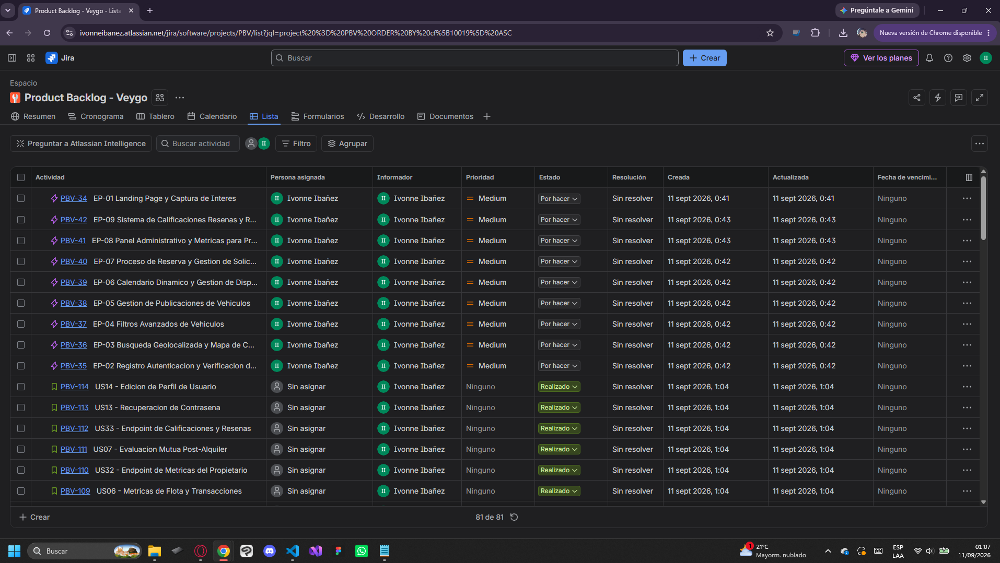

# Capítulo III: Requirements Specification

---

## 3.1 User Stories

En esta sección se definen las Historias de Usuario (User Stories) y las Historias Técnicas (Technical Stories) de Veygo, estructuradas a partir de los Épicos identificados. Se consideran tres tipos de rol para la redacción: **Cliente** y **Propietario** (usuarios autenticados de la plataforma), **Visitante** (rol base para las historias del sitio web estático o Landing Page) y **Developer** (rol utilizado en las Historias Técnicas orientadas al API RESTful). Cada historia sigue el formato estándar (Como [Rol] Quiero [Acción] Para [Beneficio]), Escenarios y sus Criterios de Aceptación se redactan en tiempo presente, tercera persona, sin referencias a interfaz de usuario, siguiendo la estructura Gherkin (Given–When–Then / Dado que–Cuando–Entonces).

**Epics**

Las Epics representan agrupaciones de alto nivel que organizan las funcionalidades principales de Veygo. Cada épica reúne un conjunto de historias de usuario relacionadas, permitiendo estructurar el sistema en bloques funcionales y facilitar la planificación del desarrollo de manera clara y escalable. En la gestión ágil, mantener una jerarquía clara donde las Épicas grandes se desglosan en Historias de Usuario específicas es fundamental para organizar el flujo de trabajo del equipo de desarrollo.

| Epic ID | Title | Description | Acceptance Criteria | Related to (Epic ID) |
| :--- | :--- | :--- | :--- | :--- |
| **EP-01** | Landing Page y Captura de Interés | **Como visitante**, **quiero** conocer la propuesta de valor de Veygo y explorar sus categorías de vehículos, **para** decidir si registrarme como cliente o como propietario. | No aplicable | No aplicable |
| **EP-02** | Registro, Autenticación y Verificación de Identidad | **Como usuario**, **quiero** registrarme, iniciar sesión y verificar mi identidad, **para** acceder a la plataforma de forma segura y generar confianza en mis transacciones. | No aplicable | No aplicable |
| **EP-03** | Búsqueda Geolocalizada y Mapa de Cercanía | **Como cliente**, **quiero** visualizar los vehículos disponibles cercanos a mi ubicación, **para** elegir el punto de entrega más conveniente. | No aplicable | No aplicable |
| **EP-04** | Filtros Avanzados de Vehículos | **Como cliente**, **quiero** filtrar los vehículos por tipo, transmisión, motorización y precio, **para** encontrar rápidamente opciones que se ajusten a mis necesidades. | No aplicable | No aplicable |
| **EP-05** | Gestión de Publicaciones de Vehículos | **Como propietario**, **quiero** registrar, editar y administrar mis vehículos publicados, **para** mantener actualizada mi oferta de alquiler. | No aplicable | No aplicable |
| **EP-06** | Calendario Dinámico y Gestión de Disponibilidad | **Como propietario**, **quiero** gestionar la disponibilidad de mis vehículos en tiempo real, **para** evitar solapamientos y conflictos entre reservas. | No aplicable | No aplicable |
| **EP-07** | Proceso de Reserva y Gestión de Solicitudes | **Como cliente**, **quiero** solicitar y confirmar el alquiler de un vehículo directamente en la plataforma, **para** evitar la coordinación por canales informales. | No aplicable | No aplicable |
| **EP-08** | Panel Administrativo y Métricas para Propietarios | **Como propietario**, **quiero** visualizar métricas de mis vehículos activos, reservas e ingresos, **para** monitorear el desempeño de mi actividad de alquiler. | No aplicable | No aplicable |
| **EP-09** | Sistema de Calificaciones, Reseñas y Reputación | **Como cliente** o propietario, **quiero** calificar y leer reseñas de otros usuarios, **para** tomar decisiones de alquiler con mayor confianza. | No aplicable | No aplicable |

_(Tabla 1. Epics del proyecto - Elaboración propia)_

Las Historias de Usuario describen de manera detallada las funcionalidades del sistema desde la perspectiva de los distintos actores de Veygo. Cada historia especifica el objetivo del usuario, sus criterios de aceptación y escenarios de uso, lo que permite validar el comportamiento esperado del sistema. Esto facilita una comprensión clara de los requerimientos y guía el desarrollo incremental del producto  dado.

| Story ID | Título | Descripción | Criterios de aceptación | Epic ID |
| :--- | :--- | :--- | :--- | :--- |
| **US01** | Verificación de identidad de usuarios | **Como** usuario registrado, **quiero** subir mi DNI y mi brevete, **para** validar mi identidad antes de realizar transacciones. | **Escenario 1: Envío de documentos válidos** **Dado que** el usuario tiene una cuenta registrada sin verificar **Cuando** envía las imágenes de su DNI y de su brevete vigente **Entonces** el estado de su cuenta cambia a "En verificación" **Y** recibe una notificación de recepción.  **Escenario 2: Brevete vencido** **Dado que** el usuario tiene una cuenta registrada sin verificar **Cuando** envía un brevete cuya fecha de vigencia ya expiró **Entonces** el sistema rechaza la solicitud **Y** le informa que debe registrar un brevete vigente. | EP-02 |
| **US02** | Inicio de sesión seguro | **Como** usuario registrado, **quiero** iniciar sesión con mis credenciales, **para** acceder de forma segura a mi perfil y reservas. | **Escenario 1: Credenciales correctas** **Dado que** el usuario tiene una cuenta activa **Cuando** ingresa su correo y contraseña correctos **Entonces** el sistema le otorga acceso **Y** lo dirige al inicio correspondiente a su rol (cliente o propietario).  **Escenario 2: Credenciales incorrectas** **Dado que** el usuario tiene una cuenta activa **Cuando** ingresa una contraseña incorrecta **Entonces** el sistema deniega el acceso **Y** le informa que las credenciales no son válidas. | EP-02 |
| **US03** | Búsqueda de vehículos cercanos | **Como** cliente, **quiero** ubicar vehículos disponibles cerca de mi posición, **para** elegir el punto de entrega más conveniente. | **Escenario 1: Vehículos dentro del radio** **Dado que** el cliente comparte su ubicación **Cuando** busca vehículos disponibles en un radio de 5 km **Entonces** el sistema muestra en el mapa los vehículos publicados dentro de ese radio **Y** su distancia aproximada.  **Escenario 2: Sin vehículos cercanos** **Dado que** el cliente comparte su ubicación **Cuando** no existen vehículos disponibles dentro del radio de búsqueda **Entonces** el sistema le informa que no hay resultados **Y** le sugiere ampliar el radio de búsqueda. | EP-03 |
| **US04** | Filtrado por transmisión y energía | **Como** cliente, **quiero** filtrar vehículos por transmisión y motorización, **para** encontrar opciones acordes a mis necesidades. | **Escenario 1: Filtros con coincidencias** **Dado que** el cliente consulta el catálogo de vehículos **Cuando** selecciona transmisión automática y motorización eléctrica **Entonces** el sistema muestra solo los vehículos que cumplen ambos criterios.  **Escenario 2: Filtros sin coincidencias** **Dado que** el cliente consulta el catálogo de vehículos **Cuando** aplica una combinación de filtros sin vehículos disponibles **Entonces** el sistema le informa que no hay resultados **Y** le permite limpiar los filtros. | EP-04 |
| **US05** | Sincronización automática de disponibilidad | **Como** propietario, **quiero** que el calendario bloquee las fechas confirmadas, **para** evitar cruces de reservas. | **Escenario 1: Bloqueo por reserva confirmada** **Dado que** el propietario confirma una reserva de su vehículo **Cuando** se registra la confirmación **Entonces** las fechas de esa reserva quedan bloqueadas en el calendario del vehículo **Y** no pueden ser solicitadas por otros clientes.  **Escenario 2: Liberación por cancelación** **Dado que** existe una reserva confirmada con fechas bloqueadas **Cuando** la reserva es cancelada **Entonces** las fechas vuelven a estar disponibles en el calendario. | EP-06 |
| **US06** | Métricas de flota y transacciones | **Como** propietario, **quiero** visualizar el resumen de mis vehículos y transacciones, **para** monitorear mi desempeño. | **Escenario 1: Propietario con actividad** **Dado que** el propietario tiene vehículos publicados y reservas completadas **Cuando** consulta su panel de métricas **Entonces** visualiza la cantidad de vehículos activos, las reservas del periodo y los ingresos acumulados.  **Escenario 2: Propietario sin actividad** **Dado que** el propietario aún no tiene reservas completadas **Cuando** consulta su panel de métricas **Entonces** el sistema muestra las métricas en cero **Y** le sugiere publicar un vehículo. | EP-08 |
| **US07** | Evaluación mutua post-alquiler | **Como** cliente o propietario, **quiero** calificar y reseñar a la otra parte tras un alquiler, **para** fomentar la transparencia y la reputación. | **Escenario 1: Reseña de un alquiler finalizado** **Dado que** el usuario tiene una reserva en estado "Completada" **Cuando** registra una calificación de 1 a 5 estrellas y un comentario **Entonces** la reseña se publica **Y** se actualiza el promedio de calificaciones de la otra parte.  **Escenario 2: Reseña de un alquiler no finalizado** **Dado que** el usuario tiene una reserva que aún no ha finalizado **Cuando** intenta registrar una reseña **Entonces** el sistema no le permite calificar **Y** le informa que debe esperar a que finalice el alquiler. | EP-09 |
| **US08** | Navegación principal y selector de idioma | **Como** visitante, **quiero** navegar entre las secciones y cambiar el idioma, **para** orientarme y consultar la información en mi idioma. | **Escenario 1: Navegación entre secciones** **Dado que** el visitante se encuentra en la Landing Page **Cuando** elige una sección del menú principal **Entonces** la página se desplaza hasta la sección seleccionada.  **Escenario 2: Cambio de idioma** **Dado que** el visitante consulta la Landing Page en español **Cuando** selecciona el idioma inglés **Entonces** todos los textos de la página se muestran en inglés **Y** la preferencia se conserva al volver a ingresar. | EP-01 |
| **US09** | Buscador rápido de vehículos | **Como** visitante, **quiero** ingresar ubicación, fechas y categoría, **para** iniciar de inmediato la búsqueda de vehículos. | **Escenario 1: Búsqueda con datos completos** **Dado que** el visitante se encuentra en la Landing Page **Cuando** ingresa una ubicación, un rango de fechas válido y una categoría **Entonces** es dirigido a la búsqueda de vehículos de la aplicación con esos criterios.  **Escenario 2: Fechas inválidas** **Dado que** el visitante completa el buscador **Cuando** la fecha de devolución es anterior a la fecha de recojo **Entonces** el sistema no realiza la búsqueda **Y** le indica que corrija el rango de fechas. | EP-01 |
| **US10** | Exploración por categorías de propósito | **Como** visitante, **quiero** conocer las categorías de uso, **para** filtrar el catálogo según el tipo de experiencia que busco. | **Escenario 1: Visualización de categorías** **Dado que** el visitante se encuentra en la Landing Page **Cuando** consulta la sección de categorías **Entonces** visualiza las categorías disponibles con su descripción.  **Escenario 2: Selección de una categoría** **Dado que** el visitante consulta las categorías **Cuando** elige una categoría **Entonces** es dirigido al catálogo filtrado por esa categoría. | EP-01 |
| **US11** | Visualización de vehículos destacados | **Como** visitante, **quiero** conocer los vehículos destacados con su información principal, **para** evaluar opciones atractivas. | **Escenario 1: Vehículos destacados disponibles** **Dado que** el visitante se encuentra en la Landing Page **Cuando** consulta la sección de vehículos destacados **Entonces** visualiza cada vehículo con su foto, modelo, tipo y tarifa diaria.  **Escenario 2: Acceso al catálogo completo** **Dado que** el visitante consulta los vehículos destacados **Cuando** solicita ver todos los modelos **Entonces** es dirigido al catálogo de la aplicación. | EP-01 |
| **US12** | Redirección a registro según rol | **Como** visitante, **quiero** acceder al registro correspondiente a mi intención, **para** iniciar directamente el proceso adecuado. | **Escenario 1: Registro como cliente** **Dado que** el visitante desea alquilar un vehículo **Cuando** elige la opción "Quiero alquilar un vehículo" **Entonces** es dirigido al registro con el rol de cliente.  **Escenario 2: Registro como propietario** **Dado que** el visitante desea publicar su vehículo **Cuando** elige la opción "Quiero publicar mi vehículo" **Entonces** es dirigido al registro con el rol de propietario. | EP-01 |
| **US13** | Recuperación de contraseña | **Como** usuario registrado, **quiero** restablecer mi contraseña mediante mi correo, **para** recuperar el acceso si la olvido. | **Escenario 1: Correo registrado** **Dado que** el usuario olvidó su contraseña **Cuando** solicita la recuperación con un correo registrado **Entonces** recibe un enlace temporal para definir una nueva contraseña.  **Escenario 2: Enlace expirado** **Dado que** el usuario recibió un enlace de recuperación **Cuando** lo utiliza después de su tiempo de validez **Entonces** el sistema rechaza el cambio **Y** le solicita generar un nuevo enlace. | EP-02 |
| **US14** | Edición de perfil de usuario | **Como** usuario registrado, **quiero** actualizar mis datos personales, **para** mantener mi información vigente. | **Escenario 1: Datos válidos** **Dado que** el usuario consulta su perfil **Cuando** actualiza su teléfono, foto o preferencias con datos válidos **Entonces** el sistema guarda los cambios **Y** muestra la información actualizada.  **Escenario 2: Datos inválidos** **Dado que** el usuario edita su perfil **Cuando** ingresa un teléfono con formato inválido **Entonces** el sistema no guarda los cambios **Y** le indica el campo que debe corregir. | EP-02 |
| **US15** | Publicación de nuevo vehículo | **Como** propietario, **quiero** registrar un vehículo con sus características y tarifa, **para** ofrecerlo en alquiler. | **Escenario 1: Publicación completa** **Dado que** el propietario tiene su identidad verificada **Cuando** registra un vehículo con fotos, especificaciones, ubicación y tarifa diaria **Entonces** el vehículo se publica **Y** queda visible en el catálogo.  **Escenario 2: Información incompleta** **Dado que** el propietario registra un vehículo **Cuando** omite un dato obligatorio, como la tarifa o la ubicación **Entonces** el sistema no publica el vehículo **Y** le indica los datos faltantes. | EP-05 |
| **US16** | Edición o retiro de publicación | **Como** propietario, **quiero** editar o retirar un vehículo publicado, **para** mantener actualizada mi oferta. | **Escenario 1: Edición de la publicación** **Dado que** el propietario tiene un vehículo publicado **Cuando** modifica su tarifa o descripción **Entonces** el catálogo muestra la información actualizada.  **Escenario 2: Retiro con reservas activas** **Dado que** el vehículo tiene reservas confirmadas pendientes **Cuando** el propietario intenta retirarlo **Entonces** el sistema no permite el retiro **Y** le informa que primero debe gestionar esas reservas. | EP-05 |
| **US17** | Solicitud de reserva | **Como** cliente, **quiero** enviar una solicitud de alquiler, **para** iniciar el proceso sin canales informales. | **Escenario 1: Fechas disponibles** **Dado que** el cliente tiene su identidad verificada **Cuando** solicita un vehículo para un rango de fechas disponible **Entonces** el sistema registra la reserva en estado "Pendiente" **Y** muestra el costo total calculado.  **Escenario 2: Fechas ocupadas** **Dado que** el cliente consulta un vehículo **Cuando** solicita fechas que se cruzan con una reserva confirmada o un bloqueo **Entonces** el sistema rechaza la solicitud **Y** le informa que esas fechas no están disponibles. | EP-07 |
| **US18** | Confirmación o rechazo de solicitud | **Como** propietario, **quiero** aceptar o rechazar las solicitudes recibidas, **para** controlar el acceso a mi vehículo. | **Escenario 1: Aceptación de la solicitud** **Dado que** el propietario tiene una solicitud pendiente **Cuando** la acepta **Entonces** la reserva cambia a estado "Confirmada" **Y** el cliente recibe una notificación.  **Escenario 2: Rechazo de la solicitud** **Dado que** el propietario tiene una solicitud pendiente **Cuando** la rechaza **Entonces** la reserva cambia a estado "Rechazada" **Y** el cliente recibe una notificación. | EP-07 |
| **US19** | Cancelación de reserva | **Como** cliente o propietario, **quiero** cancelar una reserva confirmada, **para** liberar el vehículo ante cambios de planes. | **Escenario 1: Cancelación permitida** **Dado que** existe una reserva confirmada que aún no ha iniciado **Cuando** el cliente o el propietario la cancela **Entonces** la reserva cambia a estado "Cancelada" **Y** las fechas se liberan en el calendario.  **Escenario 2: Reserva en curso** **Dado que** el alquiler ya inició **Cuando** el usuario intenta cancelar la reserva **Entonces** el sistema no permite la cancelación. | EP-07 |
| **US20** | Historial de reservas | **Como** cliente o propietario, **quiero** consultar mi historial de reservas, **para** dar seguimiento a mi actividad. | **Escenario 1: Consulta del historial** **Dado que** el usuario tiene reservas registradas **Cuando** consulta su historial **Entonces** visualiza sus reservas con el vehículo, las fechas, el monto y el estado.  **Escenario 2: Filtro por estado** **Dado que** el usuario consulta su historial **Cuando** filtra por un estado, como "Completada" **Entonces** solo visualiza las reservas con ese estado. | EP-07 |
| **US21** | Notificaciones de actividad | **Como** usuario registrado, **quiero** recibir notificaciones de los cambios en mis solicitudes y reservas, **para** estar informado. | **Escenario 1: Nueva notificación** **Dado que** una reserva del usuario cambia de estado **Cuando** se registra el cambio **Entonces** el usuario recibe una notificación con el detalle del cambio.  **Escenario 2: Notificación leída** **Dado que** el usuario tiene notificaciones sin leer **Cuando** abre una notificación **Entonces** esta se marca como leída **Y** disminuye el contador de notificaciones pendientes. | EP-07 |
| **US22** | Sección de confianza y seguridad | **Como** visitante, **quiero** conocer las medidas de seguridad de la plataforma, **para** decidir con confianza si registrarme. | **Escenario 1: Consulta de las medidas de seguridad** **Dado que** el visitante se encuentra en la Landing Page **Cuando** consulta la sección de confianza **Entonces** visualiza las medidas de seguridad, como la verificación de identidad y las reseñas.  **Escenario 2: Consulta de los términos** **Dado que** el visitante consulta la sección de confianza **Cuando** solicita más información **Entonces** accede a los términos y condiciones de la plataforma. | EP-01 |
| **US23** | Sección de preguntas frecuentes | **Como** visitante, **quiero** consultar las preguntas frecuentes, **para** resolver mis dudas antes de registrarme. | **Escenario 1: Despliegue de una respuesta** **Dado que** el visitante consulta la sección de preguntas frecuentes **Cuando** selecciona una pregunta **Entonces** se muestra su respuesta.  **Escenario 2: Cierre de una respuesta** **Dado que** el visitante tiene una respuesta desplegada **Cuando** selecciona otra pregunta **Entonces** la respuesta anterior se oculta **Y** se muestra la nueva. | EP-01 |
| **US24** | Suscripción a novedades | **Como** visitante, **quiero** registrar mi correo para recibir novedades, **para** mantenerme informado antes de registrarme. | **Escenario 1: Correo válido** **Dado que** el visitante se encuentra en la sección de suscripción **Cuando** ingresa un correo con formato válido **Entonces** el sistema registra la suscripción **Y** muestra un mensaje de confirmación.  **Escenario 2: Correo inválido** **Dado que** el visitante se encuentra en la sección de suscripción **Cuando** ingresa un correo con formato inválido **Entonces** el sistema no registra la suscripción **Y** le solicita corregir el correo. | EP-01 |
| **TS25** | Endpoint de registro y autenticación | **Como** developer, **quiero** exponer endpoints de registro, inicio de sesión y renovación de sesión, **para** que los clientes gestionen la autenticación de forma segura. | **Escenario 1: Registro exitoso** **Dado que** el endpoint `POST /api/v1/authentication/sign-up` está disponible **Cuando** recibe un correo no registrado, una contraseña válida y un rol **Entonces** almacena la contraseña cifrada con BCrypt **Y** responde `201 Created` con los datos del usuario.  **Escenario 2: Inicio de sesión exitoso** **Dado que** el endpoint `POST /api/v1/authentication/sign-in` está disponible **Cuando** recibe credenciales válidas **Entonces** responde `200 OK` con un token JWT.  **Escenario 3: Correo duplicado** **Dado que** el correo ya está registrado **Cuando** se envía a `POST /api/v1/authentication/sign-up` **Entonces** responde `409 Conflict` con un mensaje descriptivo. | EP-02 |
| **TS26** | Endpoint de verificación de identidad | **Como** developer, **quiero** exponer un endpoint que reciba documentos y actualice el estado de verificación, **para** automatizar la validación documental. | **Escenario 1: Documentos recibidos** **Dado que** el usuario está autenticado con un token JWT válido **Cuando** se envían las imágenes de DNI y brevete a `POST /api/v1/users/{userId}/identity-verification` **Entonces** el estado del usuario cambia a "En verificación" **Y** responde `202 Accepted`.  **Escenario 2: Archivo no permitido** **Dado que** el usuario está autenticado **Cuando** se envía un archivo que no es `.jpg` ni `.png` o que supera los 5 MB **Entonces** responde `400 Bad Request` indicando el error. | EP-02 |
| **TS27** | Endpoint de búsqueda geolocalizada | **Como** developer, **quiero** exponer un endpoint que retorne vehículos por coordenadas y radio, **para** soportar la búsqueda por cercanía. | **Escenario 1: Búsqueda por radio** **Dado que** existen vehículos publicados con ubicación registrada **Cuando** se consulta `GET /api/v1/vehicles?latitude={lat}&longitude={lng}&radius={km}` **Entonces** responde `200 OK` con los vehículos dentro del radio, ordenados por distancia.  **Escenario 2: Coordenadas inválidas** **Dado que** el endpoint está disponible **Cuando** se envía una latitud o longitud fuera de rango **Entonces** responde `400 Bad Request`. | EP-03 |
| **TS28** | Endpoint de filtros de catálogo | **Como** developer, **quiero** exponer un endpoint que combine parámetros de filtro, **para** acotar los resultados a las preferencias del cliente. | **Escenario 1: Filtros combinados** **Dado que** existen vehículos publicados **Cuando** se consulta `GET /api/v1/vehicles?transmission=AUTOMATIC&energyType=ELECTRIC` **Entonces** responde `200 OK` solo con los vehículos que cumplen todos los filtros.  **Escenario 2: Valor de filtro no válido** **Dado que** el endpoint está disponible **Cuando** se envía un valor de transmisión no reconocido **Entonces** responde `400 Bad Request`. | EP-04 |
| **TS29** | Endpoints CRUD de publicación de vehículos | **Como** developer, **quiero** exponer endpoints CRUD para vehículos, **para** soportar la gestión de flota de los propietarios. | **Escenario 1: Creación de vehículo** **Dado que** el propietario está autenticado **Cuando** se envían datos válidos a `POST /api/v1/vehicles` **Entonces** el vehículo se persiste en la base de datos **Y** responde `201 Created`.  **Escenario 2: Edición por otro usuario** **Dado que** el vehículo pertenece a otro propietario **Cuando** se intenta modificarlo con `PUT /api/v1/vehicles/{vehicleId}` **Entonces** responde `403 Forbidden`.  **Escenario 3: Vehículo inexistente** **Dado que** el identificador no existe **Cuando** se consulta `GET /api/v1/vehicles/{vehicleId}` **Entonces** responde `404 Not Found`. | EP-05 |
| **TS30** | Endpoint de calendario de disponibilidad | **Como** developer, **quiero** exponer un endpoint que retorne y actualice el calendario de un vehículo, **para** evitar el solapamiento de reservas. | **Escenario 1: Consulta del calendario** **Dado que** el vehículo tiene reservas y fechas bloqueadas **Cuando** se consulta `GET /api/v1/vehicles/{vehicleId}/availability` **Entonces** responde `200 OK` con las fechas reservadas y bloqueadas.  **Escenario 2: Bloqueo de fechas reservadas** **Dado que** existe una reserva confirmada en un rango de fechas **Cuando** el propietario intenta bloquear ese mismo rango con `POST /api/v1/vehicles/{vehicleId}/blocked-dates` **Entonces** responde `409 Conflict`. | EP-06 |
| **TS31** | Endpoints de solicitud y confirmación de reserva | **Como** developer, **quiero** exponer endpoints para crear y actualizar el estado de una reserva, **para** soportar el flujo completo entre cliente y propietario. | **Escenario 1: Creación de reserva** **Dado que** las fechas solicitadas están disponibles **Cuando** se envía la solicitud a `POST /api/v1/bookings` **Entonces** la reserva se registra en estado `PENDING` **Y** responde `201 Created`.  **Escenario 2: Cruce de fechas** **Dado que** existe una reserva confirmada en las fechas solicitadas **Cuando** se envía una nueva solicitud a `POST /api/v1/bookings` **Entonces** responde `409 Conflict`.  **Escenario 3: Cambio de estado** **Dado que** la reserva está en estado `PENDING` **Cuando** el propietario envía `PATCH /api/v1/bookings/{bookingId}` con estado `CONFIRMED` **Entonces** la reserva cambia de estado **Y** responde `200 OK`. | EP-07 |
| **TS32** | Endpoint de métricas del propietario | **Como** developer, **quiero** exponer un endpoint que agregue métricas de vehículos, reservas e ingresos, **para** alimentar el panel administrativo. | **Escenario 1: Consulta de métricas** **Dado que** el propietario está autenticado **Cuando** se consulta `GET /api/v1/owners/{ownerId}/metrics` **Entonces** responde `200 OK` con los vehículos activos, las reservas del periodo y los ingresos acumulados.  **Escenario 2: Acceso no autorizado** **Dado que** el usuario autenticado no es el propietario consultado **Cuando** solicita sus métricas **Entonces** responde `403 Forbidden`. | EP-08 |
| **TS33** | Endpoint de calificaciones y reseñas | **Como** developer, **quiero** exponer un endpoint para registrar y consultar calificaciones, **para** soportar el sistema de reputación. | **Escenario 1: Registro de reseña** **Dado que** la reserva está en estado `COMPLETED` **Cuando** se envía una calificación de 1 a 5 y un comentario a `POST /api/v1/reviews` **Entonces** la reseña se registra **Y** responde `201 Created`.  **Escenario 2: Calificación fuera de rango** **Dado que** el endpoint está disponible **Cuando** se envía una calificación menor a 1 o mayor a 5 **Entonces** responde `400 Bad Request`. | EP-09 |
| **TS34** | Endpoint de contenido optimizado para Landing Page | **Como** developer, **quiero** exponer un endpoint con soporte de caché HTTP para el contenido de la Landing Page, **para** reducir la cantidad de datos transferidos por petición. | **Escenario 1: Primera consulta** **Dado que** el endpoint `GET /api/v1/landing/content` está disponible **Cuando** se consulta por primera vez **Entonces** responde `200 OK` con el contenido y el encabezado `ETag`.  **Escenario 2: Contenido sin cambios** **Dado que** el cliente envía el encabezado `If-None-Match` con el `ETag` vigente **Cuando** el contenido no ha cambiado **Entonces** responde `304 Not Modified` sin cuerpo. | EP-01 |
| **TS35** | Endpoint de recursos de internacionalización (i18n) | **Como** developer, **quiero** exponer un endpoint que retorne los textos traducidos según el idioma solicitado, **para** soportar el cambio de idioma en el cliente. | **Escenario 1: Idioma soportado** **Dado que** existen traducciones en español e inglés **Cuando** se consulta `GET /api/v1/i18n/en` **Entonces** responde `200 OK` con los textos en inglés.  **Escenario 2: Idioma no soportado** **Dado que** el idioma solicitado no tiene traducciones **Cuando** se consulta `GET /api/v1/i18n/{locale}` **Entonces** responde `200 OK` con los textos en español como idioma por defecto. | EP-01 |
| **TS36** | Endpoint de registro de eventos de conversión | **Como** developer, **quiero** exponer un endpoint que reciba eventos de interacción, **para** alimentar la analítica de conversión de la Landing Page. | **Escenario 1: Evento válido** **Dado que** el endpoint `POST /api/v1/conversion-events` está disponible **Cuando** recibe un evento con tipo, sección y fecha **Entonces** registra el evento **Y** responde `201 Created`.  **Escenario 2: Evento incompleto** **Dado que** el endpoint está disponible **Cuando** recibe un evento sin tipo **Entonces** responde `400 Bad Request`. | EP-01 |
| **US37** | Registro de usuario por rol | **Como** visitante, **quiero** crear una cuenta eligiendo si seré cliente o propietario, **para** acceder a las funciones que corresponden a mi rol. | **Escenario 1: Registro exitoso** **Dado que** el visitante no tiene una cuenta **Cuando** completa sus datos personales, elige su rol y acepta los términos y condiciones **Entonces** el sistema crea la cuenta con el rol seleccionado **Y** lo dirige al inicio correspondiente a ese rol.  **Escenario 2: Correo ya registrado** **Dado que** existe una cuenta con el correo ingresado **Cuando** el visitante intenta registrarse con ese correo **Entonces** el sistema no crea la cuenta **Y** le informa que el correo ya está en uso. | EP-02 |
| **US38** | Detalle del vehículo | **Como** cliente, **quiero** consultar la información completa de un vehículo, **para** decidir si lo reservo. | **Escenario 1: Consulta del detalle** **Dado que** el cliente encuentra un vehículo publicado **Cuando** consulta su detalle **Entonces** visualiza la galería de fotos, las especificaciones, la tarifa diaria, la ubicación de recojo y la reputación del propietario.  **Escenario 2: Vehículo retirado** **Dado que** el propietario retiró la publicación del vehículo **Cuando** el cliente intenta consultar su detalle **Entonces** el sistema le informa que el vehículo ya no está disponible. | EP-03 |
| **US39** | Vehículos favoritos | **Como** cliente, **quiero** guardar vehículos como favoritos, **para** revisarlos más tarde sin volver a buscarlos. | **Escenario 1: Guardar un favorito** **Dado que** el cliente consulta un vehículo que no está en sus favoritos **Cuando** lo marca como favorito **Entonces** el vehículo se agrega a su lista de favoritos.  **Escenario 2: Quitar un favorito** **Dado que** el vehículo ya está en los favoritos del cliente **Cuando** lo desmarca **Entonces** el vehículo se retira de su lista de favoritos. | EP-03 |
| **US40** | Inicio del arrendatario | **Como** cliente, **quiero** contar con una página de inicio con búsqueda rápida, vehículos recomendados y mis próximas reservas, **para** acceder rápidamente a lo que necesito. | **Escenario 1: Cliente con reservas** **Dado que** el cliente tiene reservas confirmadas **Cuando** ingresa a su inicio **Entonces** visualiza la búsqueda rápida, los vehículos recomendados cercanos y sus próximas reservas.  **Escenario 2: Cliente sin reservas** **Dado que** el cliente aún no tiene reservas **Cuando** ingresa a su inicio **Entonces** visualiza la búsqueda rápida y los vehículos recomendados **Y** un mensaje que lo invita a realizar su primera reserva. | EP-03 |
| **US41** | Mensajería entre cliente y propietario | **Como** cliente o propietario, **quiero** intercambiar mensajes con la otra parte, **para** resolver dudas y coordinar el alquiler dentro de la plataforma. | **Escenario 1: Envío de un mensaje** **Dado que** el cliente tiene una conversación con el propietario de un vehículo **Cuando** envía un mensaje **Entonces** el mensaje se muestra en la conversación **Y** el propietario recibe una notificación.  **Escenario 2: Mensaje vacío** **Dado que** el usuario se encuentra en una conversación **Cuando** intenta enviar un mensaje sin contenido **Entonces** el sistema no envía el mensaje. | EP-07 |
| **US42** | Historial de transacciones y reporte | **Como** propietario, **quiero** consultar mis transacciones y descargar un reporte, **para** llevar el control de mis ingresos. | **Escenario 1: Consulta por rango de fechas** **Dado que** el propietario tiene transacciones registradas **Cuando** selecciona un rango de fechas **Entonces** visualiza el resumen de ingresos, los gráficos por mes y por vehículo y el historial de transacciones del periodo.  **Escenario 2: Descarga del reporte** **Dado que** el propietario consulta sus transacciones **Cuando** solicita descargar el reporte **Entonces** el sistema genera un archivo CSV con las transacciones del periodo seleccionado. | EP-08 |
| **US43** | Cierre de sesión | **Como** usuario registrado, **quiero** cerrar mi sesión, **para** proteger mi cuenta en dispositivos compartidos. | **Escenario 1: Cierre de sesión** **Dado que** el usuario tiene una sesión activa **Cuando** cierra su sesión **Entonces** el sistema elimina la sesión **Y** lo dirige a la página de inicio de sesión.  **Escenario 2: Acceso tras cerrar sesión** **Dado que** el usuario cerró su sesión **Cuando** intenta acceder a una sección privada **Entonces** el sistema le solicita iniciar sesión nuevamente. | EP-02 |
| **US44** | Pago de la reserva | **Como** cliente, **quiero** pagar mi reserva dentro de la plataforma, **para** asegurar el vehículo sin coordinar pagos por canales informales. | **Escenario 1: Pago aprobado** **Dado que** el propietario confirmó la reserva del cliente **Cuando** el cliente paga el monto total con un medio de pago válido **Entonces** el pago se registra como completado **Y** ambas partes reciben la confirmación.  **Escenario 2: Pago rechazado** **Dado que** el cliente intenta pagar su reserva **Cuando** el medio de pago es rechazado **Entonces** el sistema no confirma el pago **Y** le solicita intentarlo con otro medio de pago. | EP-07 |
| **US45** | Reembolso por cancelación | **Como** cliente, **quiero** recibir el reembolso cuando una reserva pagada se cancela, **para** no perder mi dinero ante cambios de planes. | **Escenario 1: Cancelación dentro del plazo** **Dado que** el cliente tiene una reserva pagada **Cuando** la cancela con más de 48 horas de anticipación **Entonces** el sistema registra el reembolso del monto pagado **Y** le notifica la operación.  **Escenario 2: Cancelación del propietario** **Dado que** el cliente tiene una reserva pagada **Cuando** el propietario la cancela **Entonces** el sistema registra el reembolso total al cliente. | EP-07 |
| **US46** | Registro de entrega y devolución del vehículo | **Como** propietario, **quiero** registrar la entrega y la devolución del vehículo con su estado, **para** tener respaldo ante posibles daños. | **Escenario 1: Registro de la entrega** **Dado que** la reserva está confirmada y pagada **Cuando** el propietario registra la entrega con el kilometraje y el nivel de combustible **Entonces** la reserva cambia a estado "En curso".  **Escenario 2: Registro de la devolución** **Dado que** la reserva está en curso **Cuando** el propietario registra la devolución con el estado del vehículo **Entonces** la reserva cambia a estado "Completada" **Y** ambas partes quedan habilitadas para calificarse. | EP-07 |
| **US47** | Bloqueo manual de fechas | **Como** propietario, **quiero** bloquear o desbloquear fechas de mi vehículo, **para** indicar los días en que no lo ofreceré. | **Escenario 1: Bloqueo de fechas libres** **Dado que** el vehículo no tiene reservas en las fechas seleccionadas **Cuando** el propietario las bloquea **Entonces** esas fechas no pueden ser solicitadas por los clientes.  **Escenario 2: Bloqueo de fechas reservadas** **Dado que** existe una reserva confirmada en las fechas seleccionadas **Cuando** el propietario intenta bloquearlas **Entonces** el sistema no realiza el bloqueo **Y** le informa que esas fechas ya están reservadas. | EP-06 |
| **US48** | Sección "Cómo funciona" | **Como** visitante, **quiero** conocer los pasos para alquilar un vehículo en Veygo, **para** entender el proceso antes de registrarme. | **Escenario 1: Consulta del proceso** **Dado que** el visitante se encuentra en la Landing Page **Cuando** consulta la sección "Cómo funciona" **Entonces** visualiza los cuatro pasos del proceso: crear cuenta, encontrar el vehículo, reservar y pagar, y disfrutar el viaje.  **Escenario 2: Acceso desde el menú** **Dado que** el visitante se encuentra en cualquier sección de la Landing Page **Cuando** elige "Cómo funciona" en el menú principal **Entonces** la página se desplaza hasta esa sección. | EP-01 |
| **US49** | Sección de testimonios | **Como** visitante, **quiero** leer las opiniones de otros usuarios, **para** confiar en la plataforma antes de registrarme. | **Escenario 1: Consulta de testimonios** **Dado que** el visitante se encuentra en la Landing Page **Cuando** consulta la sección de testimonios **Entonces** visualiza las opiniones con el nombre, el rol y la calificación de cada usuario.  **Escenario 2: Cambio de idioma** **Dado que** el visitante consulta los testimonios en español **Cuando** cambia el idioma a inglés **Entonces** los textos de la sección se muestran en inglés. | EP-01 |
| **US50** | Contacto y redes sociales | **Como** visitante, **quiero** acceder a los canales de contacto y redes sociales de Veygo, **para** resolver dudas y seguir las novedades de la plataforma. | **Escenario 1: Acceso a redes sociales** **Dado que** el visitante se encuentra en el footer de la Landing Page **Cuando** selecciona el ícono de una red social **Entonces** se abre el perfil de Veygo en esa red social en una nueva pestaña.  **Escenario 2: Contacto por WhatsApp** **Dado que** el visitante necesita soporte **Cuando** selecciona "Soporte por WhatsApp" **Entonces** se abre una conversación de WhatsApp con el número de soporte de Veygo. | EP-01 |
| **TS51** | Endpoints de favoritos | **Como** developer, **quiero** exponer endpoints para agregar, listar y eliminar favoritos, **para** soportar la lista de vehículos guardados del cliente. | **Escenario 1: Agregar favorito** **Dado que** el cliente está autenticado **Cuando** se envía `POST /api/v1/favorites` con el identificador del vehículo **Entonces** el favorito se registra **Y** responde `201 Created`.  **Escenario 2: Favorito duplicado** **Dado que** el vehículo ya está en los favoritos del cliente **Cuando** se envía nuevamente `POST /api/v1/favorites` **Entonces** responde `409 Conflict`.  **Escenario 3: Eliminar favorito** **Dado que** el favorito existe **Cuando** se envía `DELETE /api/v1/favorites/{favoriteId}` **Entonces** responde `204 No Content`. | EP-03 |
| **TS52** | Endpoints de conversaciones y mensajes | **Como** developer, **quiero** exponer endpoints para crear conversaciones y enviar mensajes, **para** soportar la comunicación entre cliente y propietario. | **Escenario 1: Envío de mensaje** **Dado que** el usuario participa en la conversación **Cuando** se envía `POST /api/v1/conversations/{conversationId}/messages` con el contenido **Entonces** el mensaje se registra, se publica el evento `MessageSent` **Y** responde `201 Created`.  **Escenario 2: Usuario ajeno a la conversación** **Dado que** el usuario autenticado no participa en la conversación **Cuando** consulta `GET /api/v1/conversations/{conversationId}/messages` **Entonces** responde `403 Forbidden`. | EP-07 |
| **TS53** | Endpoints de notificaciones | **Como** developer, **quiero** exponer endpoints para listar notificaciones y marcarlas como leídas, **para** soportar la campana de notificaciones. | **Escenario 1: Listado de notificaciones** **Dado que** el usuario está autenticado **Cuando** se consulta `GET /api/v1/notifications?unread=true` **Entonces** responde `200 OK` con sus notificaciones sin leer.  **Escenario 2: Marcar como leída** **Dado que** la notificación pertenece al usuario **Cuando** se envía `PATCH /api/v1/notifications/{notificationId}` con `read: true` **Entonces** la notificación se actualiza **Y** responde `200 OK`. | EP-07 |
| **TS54** | Endpoints de perfil | **Como** developer, **quiero** exponer endpoints para consultar y actualizar el perfil del usuario, **para** soportar la gestión de datos personales, licencia y preferencias. | **Escenario 1: Actualización del perfil** **Dado que** el usuario está autenticado **Cuando** se envían datos válidos a `PUT /api/v1/profiles/{profileId}` **Entonces** el perfil se actualiza **Y** responde `200 OK`.  **Escenario 2: Documento duplicado** **Dado que** el número de documento ya pertenece a otro perfil **Cuando** se envía a `PUT /api/v1/profiles/{profileId}` **Entonces** responde `409 Conflict`. | EP-02 |
| **TS55** | Endpoints de pagos y reembolsos | **Como** developer, **quiero** exponer endpoints para procesar pagos y reembolsos mediante la pasarela de pagos, **para** soportar el cobro de las reservas. | **Escenario 1: Pago procesado** **Dado que** la reserva está en estado `CONFIRMED` **Cuando** se envía `POST /api/v1/payments` y la pasarela aprueba el cobro **Entonces** el pago se registra como `COMPLETED` **Y** responde `201 Created`.  **Escenario 2: Monto incorrecto** **Dado que** el monto enviado no coincide con el total de la reserva **Cuando** se envía `POST /api/v1/payments` **Entonces** responde `400 Bad Request`.  **Escenario 3: Reembolso** **Dado que** la reserva pagada fue cancelada **Cuando** se envía `POST /api/v1/payments/{paymentId}/refunds` **Entonces** el pago cambia a `REFUNDED` **Y** responde `201 Created`. | EP-07 |
| **TS56** | Endpoints de entrega y devolución | **Como** developer, **quiero** exponer endpoints para registrar la entrega y la devolución del vehículo, **para** controlar el inicio y el fin del alquiler. | **Escenario 1: Registro de entrega** **Dado que** la reserva está pagada **Cuando** se envía `POST /api/v1/bookings/{bookingId}/handovers` con tipo `PICKUP` **Entonces** la reserva cambia a `IN_PROGRESS` **Y** responde `201 Created`.  **Escenario 2: Entrega duplicada** **Dado que** la entrega ya fue registrada **Cuando** se envía nuevamente un registro de tipo `PICKUP` **Entonces** responde `409 Conflict`. | EP-07 |
| **TS57** | Documentación de la API con OpenAPI | **Como** developer, **quiero** documentar todos los endpoints con OpenAPI (Swagger), **para** que el equipo y los clientes de la API conozcan sus recursos, parámetros y respuestas. | **Escenario 1: Consulta de la documentación** **Dado que** la RESTful API está desplegada **Cuando** se accede a `/swagger` **Entonces** se muestran todos los endpoints agrupados por bounded context, con sus parámetros, esquemas y códigos de respuesta.  **Escenario 2: Endpoints protegidos** **Dado que** un endpoint requiere autenticación **Cuando** se consulta en la documentación **Entonces** se indica que requiere un token JWT **Y** se permite probarlo ingresando el token. | Transversal |
_(Tabla 2. User Stories del proyecto - Elaboración propia)_

---

## 3.2. Impact Mapping 

En esta sección se expone el Impact Mapping del proyecto, una tecnica que conecta los objetivos de negocio con las funcionalidades a desarrollar. El proceso inicio con la definición de los Business Goals bajo criterios SMART, seguido de la identificación de los Actores (User Personas) que influyen en su cumplimiento. Para cada actor se establecieron los Impacts esperados en su comportamiento y, a partir de ellos, se listaron los Deliverables que podrían generarlos. Finalmente, cada deliverable se vinculó con User Stories concretas que lo hacen tangible.

_Figura 1. Impact Mapping-Elaboración propia. Nota:BG1 y BG2 son especificos, medibles, alcanzables para una etapa de validación en Lima y relevante. Definidos en plazo de 6 meses._

_Figura 2. Impact Mapping-Elaboración propia. Nota: BG3 mide la adopción real de la plataforma, coherente con Hypotehsis Statement 5._

_Figura 3. Impact Mapping-Elaboración propia. Nota: BG4 ataca el problema identificado en las 5w's y 2 h's, medible como tasa porcentual con plazo definido._

---

## 3.3. Product Backlog

_Figura 4. Product Backlog - Elaboración propia. Nota: Esta figura muestra la tabla lista realizada por el grupo para ordenar el product backlog del proyecto en Jira_

**Link:** https://ivonneibanez.atlassian.net/?continue=https%3A%2F%2Fivonneibanez.atlassian.net%2Fwelcome%2Fsoftware%3FprojectId%3D10002&atlOrigin=eyJpIjoiM2Y3NTc4N2YxZDY1NDEzZGE3ZGVmYzNhZmYzZDk3NGIiLCJwIjoiamlyYS1zb2Z0d2FyZSJ9

| # Orden | User Story ID | Título | Descripción | Story Points |
| :---: | :---: | :--- | :--- | :---: |
| 1 | US09 | Buscador rápido de vehículos | Como visitante, quiero ingresar ubicación, fechas y categoría, para iniciar de inmediato la búsqueda de vehículos. | 3 |
| 2 | US11 | Visualización de vehículos destacados | Como visitante, quiero conocer los vehículos destacados con su información principal, para evaluar opciones atractivas. | 2 |
| 3 | US10 | Exploración por categorías de propósito | Como visitante, quiero conocer las categorías de uso, para filtrar el catálogo según el tipo de experiencia que busco. | 2 |
| 4 | US08 | Navegación principal y selector de idioma | Como visitante, quiero navegar entre las secciones y cambiar el idioma, para orientarme y consultar la información en mi idioma. | 3 |
| 5 | US12 | Redirección a registro según rol | Como visitante, quiero acceder al registro correspondiente a mi intención, para iniciar directamente el proceso adecuado. | 2 |
| 6 | US22 | Sección de confianza y seguridad | Como visitante, quiero conocer las medidas de seguridad de la plataforma, para decidir con confianza si registrarme. | 1 |
| 7 | US48 | Sección "Cómo funciona" | Como visitante, quiero conocer los pasos para alquilar un vehículo en Veygo, para entender el proceso antes de registrarme. | 1 |
| 8 | US49 | Sección de testimonios | Como visitante, quiero leer las opiniones de otros usuarios, para confiar en la plataforma antes de registrarme. | 1 |
| 9 | US50 | Contacto y redes sociales | Como visitante, quiero acceder a los canales de contacto y redes sociales de Veygo, para resolver dudas y seguir las novedades de la plataforma. | 2 |
| 10 | US23 | Sección de preguntas frecuentes | Como visitante, quiero consultar las preguntas frecuentes, para resolver mis dudas antes de registrarme. | 1 |
| 11 | US24 | Suscripción a novedades | Como visitante, quiero registrar mi correo para recibir novedades, para mantenerme informado antes de registrarme. | 2 |
| 12 | TS34 | Endpoint de contenido optimizado para Landing Page | Como developer, quiero exponer un endpoint con soporte de caché HTTP para el contenido de la Landing Page, para reducir la cantidad de datos transferidos por petición. | 3 |
| 13 | TS35 | Endpoint de recursos de internacionalización (i18n) | Como developer, quiero exponer un endpoint que retorne los textos traducidos según el idioma solicitado, para soportar el cambio de idioma en el cliente. | 3 |
| 14 | TS36 | Endpoint de registro de eventos de conversión | Como developer, quiero exponer un endpoint que reciba eventos de interacción, para alimentar la analítica de conversión de la Landing Page. | 2 |
| 15 | US37 | Registro de usuario por rol | Como visitante, quiero crear una cuenta eligiendo si seré cliente o propietario, para acceder a las funciones que corresponden a mi rol. | 3 |
| 16 | US02 | Inicio de sesión seguro | Como usuario registrado, quiero iniciar sesión con mis credenciales, para acceder de forma segura a mi perfil y reservas. | 3 |
| 17 | US43 | Cierre de sesión | Como usuario registrado, quiero cerrar mi sesión, para proteger mi cuenta en dispositivos compartidos. | 1 |
| 18 | TS25 | Endpoint de registro y autenticación | Como developer, quiero exponer endpoints de registro, inicio de sesión y renovación de sesión, para que los clientes gestionen la autenticación de forma segura. | 5 |
| 19 | US01 | Verificación de identidad de usuarios | Como usuario registrado, quiero subir mi DNI y mi brevete, para validar mi identidad antes de realizar transacciones. | 5 |
| 20 | TS26 | Endpoint de verificación de identidad | Como developer, quiero exponer un endpoint que reciba documentos y actualice el estado de verificación, para automatizar la validación documental. | 5 |
| 21 | US15 | Publicación de nuevo vehículo | Como propietario, quiero registrar un vehículo con sus características y tarifa, para ofrecerlo en alquiler. | 5 |
| 22 | TS29 | Endpoints CRUD de publicación de vehículos | Como developer, quiero exponer endpoints CRUD para vehículos, para soportar la gestión de flota de los propietarios. | 8 |
| 23 | US16 | Edición o retiro de publicación | Como propietario, quiero editar o retirar un vehículo publicado, para mantener actualizada mi oferta. | 3 |
| 24 | US03 | Búsqueda de vehículos cercanos | Como cliente, quiero ubicar vehículos disponibles cerca de mi posición, para elegir el punto de entrega más conveniente. | 5 |
| 25 | TS27 | Endpoint de búsqueda geolocalizada | Como developer, quiero exponer un endpoint que retorne vehículos por coordenadas y radio, para soportar la búsqueda por cercanía. | 5 |
| 26 | US04 | Filtrado por transmisión y energía | Como cliente, quiero filtrar vehículos por transmisión y motorización, para encontrar opciones acordes a mis necesidades. | 3 |
| 27 | TS28 | Endpoint de filtros de catálogo | Como developer, quiero exponer un endpoint que combine parámetros de filtro, para acotar los resultados a las preferencias del cliente. | 3 |
| 28 | US38 | Detalle del vehículo | Como cliente, quiero consultar la información completa de un vehículo, para decidir si lo reservo. | 3 |
| 29 | US40 | Inicio del arrendatario | Como cliente, quiero contar con una página de inicio con búsqueda rápida, vehículos recomendados y mis próximas reservas, para acceder rápidamente a lo que necesito. | 2 |
| 30 | US39 | Vehículos favoritos | Como cliente, quiero guardar vehículos como favoritos, para revisarlos más tarde sin volver a buscarlos. | 2 |
| 31 | TS51 | Endpoints de favoritos | Como developer, quiero exponer endpoints para agregar, listar y eliminar favoritos, para soportar la lista de vehículos guardados del cliente. | 3 |
| 32 | US05 | Sincronización automática de disponibilidad | Como propietario, quiero que el calendario bloquee las fechas confirmadas, para evitar cruces de reservas. | 5 |
| 33 | US47 | Bloqueo manual de fechas | Como propietario, quiero bloquear o desbloquear fechas de mi vehículo, para indicar los días en que no lo ofreceré. | 3 |
| 34 | TS30 | Endpoint de calendario de disponibilidad | Como developer, quiero exponer un endpoint que retorne y actualice el calendario de un vehículo, para evitar el solapamiento de reservas. | 5 |
| 35 | US17 | Solicitud de reserva | Como cliente, quiero enviar una solicitud de alquiler, para iniciar el proceso sin canales informales. | 5 |
| 36 | TS31 | Endpoints de solicitud y confirmación de reserva | Como developer, quiero exponer endpoints para crear y actualizar el estado de una reserva, para soportar el flujo completo entre cliente y propietario. | 8 |
| 37 | US18 | Confirmación o rechazo de solicitud | Como propietario, quiero aceptar o rechazar las solicitudes recibidas, para controlar el acceso a mi vehículo. | 3 |
| 38 | US19 | Cancelación de reserva | Como cliente o propietario, quiero cancelar una reserva confirmada, para liberar el vehículo ante cambios de planes. | 3 |
| 39 | US20 | Historial de reservas | Como cliente o propietario, quiero consultar mi historial de reservas, para dar seguimiento a mi actividad. | 2 |
| 40 | US21 | Notificaciones de actividad | Como usuario registrado, quiero recibir notificaciones de los cambios en mis solicitudes y reservas, para estar informado. | 3 |
| 41 | TS53 | Endpoints de notificaciones | Como developer, quiero exponer endpoints para listar notificaciones y marcarlas como leídas, para soportar la campana de notificaciones. | 3 |
| 42 | US41 | Mensajería entre cliente y propietario | Como cliente o propietario, quiero intercambiar mensajes con la otra parte, para resolver dudas y coordinar el alquiler dentro de la plataforma. | 5 |
| 43 | TS52 | Endpoints de conversaciones y mensajes | Como developer, quiero exponer endpoints para crear conversaciones y enviar mensajes, para soportar la comunicación entre cliente y propietario. | 5 |
| 44 | US06 | Métricas de flota y transacciones | Como propietario, quiero visualizar el resumen de mis vehículos y transacciones, para monitorear mi desempeño. | 3 |
| 45 | US42 | Historial de transacciones y reporte | Como propietario, quiero consultar mis transacciones y descargar un reporte, para llevar el control de mis ingresos. | 3 |
| 46 | TS32 | Endpoint de métricas del propietario | Como developer, quiero exponer un endpoint que agregue métricas de vehículos, reservas e ingresos, para alimentar el panel administrativo. | 5 |
| 47 | US07 | Evaluación mutua post-alquiler | Como cliente o propietario, quiero calificar y reseñar a la otra parte tras un alquiler, para fomentar la transparencia y la reputación. | 3 |
| 48 | TS33 | Endpoint de calificaciones y reseñas | Como developer, quiero exponer un endpoint para registrar y consultar calificaciones, para soportar el sistema de reputación. | 5 |
| 49 | US14 | Edición de perfil de usuario | Como usuario registrado, quiero actualizar mis datos personales, para mantener mi información vigente. | 2 |
| 50 | TS54 | Endpoints de perfil | Como developer, quiero exponer endpoints para consultar y actualizar el perfil del usuario, para soportar la gestión de datos personales, licencia y preferencias. | 3 |
| 51 | US13 | Recuperación de contraseña | Como usuario registrado, quiero restablecer mi contraseña mediante mi correo, para recuperar el acceso si la olvido. | 2 |
| 52 | US44 | Pago de la reserva | Como cliente, quiero pagar mi reserva dentro de la plataforma, para asegurar el vehículo sin coordinar pagos por canales informales. | 8 |
| 53 | US45 | Reembolso por cancelación | Como cliente, quiero recibir el reembolso cuando una reserva pagada se cancela, para no perder mi dinero ante cambios de planes. | 5 |
| 54 | TS55 | Endpoints de pagos y reembolsos | Como developer, quiero exponer endpoints para procesar pagos y reembolsos mediante la pasarela de pagos, para soportar el cobro de las reservas. | 8 |
| 55 | US46 | Registro de entrega y devolución del vehículo | Como propietario, quiero registrar la entrega y la devolución del vehículo con su estado, para tener respaldo ante posibles daños. | 5 |
| 56 | TS56 | Endpoints de entrega y devolución | Como developer, quiero exponer endpoints para registrar la entrega y la devolución del vehículo, para controlar el inicio y el fin del alquiler. | 5 |
| 57 | TS57 | Documentación de la API con OpenAPI | Como developer, quiero documentar todos los endpoints con OpenAPI (Swagger), para que el equipo y los clientes de la API conozcan sus recursos, parámetros y respuestas. | 3 |

_Tabla 3. Product Backlog-Veygo. Nota: Se prioriza según el orden de implementación_
